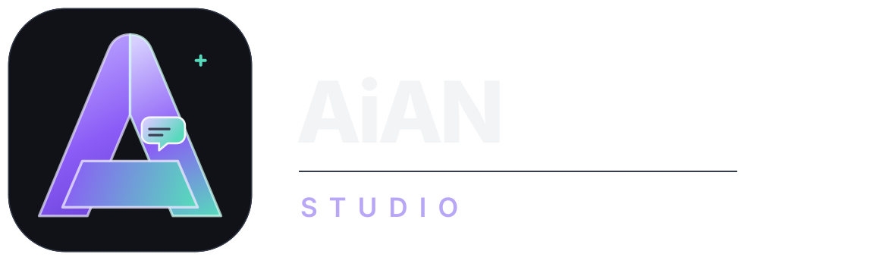

<div align="center">



# AiAN Studio

**A focused workspace for translating, cleaning and typesetting manga, manhwa and webtoons.**

[](https://github.com/meishaven/manhwa-studio/releases/latest)
[](https://github.com/meishaven/manhwa-studio/releases)
[](./LICENSE)
[](https://github.com/meishaven/manhwa-studio/releases/latest)

[**Get AiAN Studio**](https://github.com/meishaven/manhwa-studio/releases/latest) ·
[Report a problem](https://github.com/meishaven/manhwa-studio/issues) ·
[View the roadmap](./docs/AIAN_STUDIO_ROADMAP.md)

</div>

---

## The workspace

AiAN Studio brings the main scanlation workflow into one desktop workspace. Import pages, recognize text, translate, clean source lettering, adjust regions and typeset the result without constantly switching tools.

| Workspace | Purpose |
|---|---|
| **AIO Pipeline** | Run the six-stage workflow automatically or guide each stage manually |
| **Translator** | Review and translate text, including selected visual regions |
| **Cleaner / Redraw** | Remove source lettering and repair artwork |
| **Typesetter** | Adjust fonts, shapes, alignment, spacing, effects and placement |
| **Chapter tools** | Stitch, split, enhance and optimize long chapters |
| **Watermark tools** | Detect and manage unwanted page marks |
| **Library** | Organize local work and connect to the Supabase-backed chapter library |

### AIO, from source page to finished lettering

1. **Detect** — locate text and speech-bubble regions.
2. **Recognize** — extract the source text with OCR.
3. **Translate** — create the target-language text with the selected model or service.
4. **Segment** — refine regions and line layout.
5. **Clean** — remove the original lettering from the artwork.
6. **Render** — typeset the translated text onto the page.

Use Automatic mode for a complete run, or Manual mode to review, skip, rerun and adjust individual stages.

## Built around a practical desktop workflow

- **Local-model friendly.** Local processing and model choices are part of the workflow; cloud providers remain optional.
- **Review before export.** Keep control over text, regions, cleanup and typesetting rather than treating every result as final.
- **Chapter oriented.** Work with page collections and long-strip chapters, not just isolated images.
- **Your library stays yours.** The Supabase library connector reads your configured chapter records and original images; it does not edit or delete your Supabase data.
- **Incremental development.** AiAN has its own branding, release process and roadmap. The interface and workflows will continue to evolve around the AiAN project.

## Download

The Releases page contains the current Windows x64 installer and the release notes:

**[Download the latest AiAN Studio release](https://github.com/meishaven/manhwa-studio/releases/latest)**

Close AiAN Studio before running an installer update. Keep an older Manhwa Studio installation until you have checked that your settings, local models and library connection are available in AiAN.

## Project roadmap

The current priorities are:

- Backup and restore for projects and settings.
- A more useful Supabase library, with thumbnails, search, metadata and reliable page counts.
- Better Korean OCR and translation review.
- A processing queue that respects available memory and older hardware.
- Clear release notes and version history.

See [AiAN Studio Roadmap](./docs/AIAN_STUDIO_ROADMAP.md) for the broader plan.

## Development

The repository is a Bun workspace. The desktop application is in `apps/electron`, the shared interface is in `packages/interface`, and the local AI backend is in `packages/mini-backend`.

Requirements and commands are documented in [the Electron app guide](./apps/electron/README.md).

```bash
bun install
bun run dev:electron
```

Useful checks:

```bash
bun run lint
bun run typecheck
bun run test
bun run build
```

## Credits and license

AiAN Studio is distributed under the MIT license. See [LICENSE](./LICENSE) and [third-party notices](./docs/THIRD-PARTY-NOTICES.md) for attribution and dependency notices.
